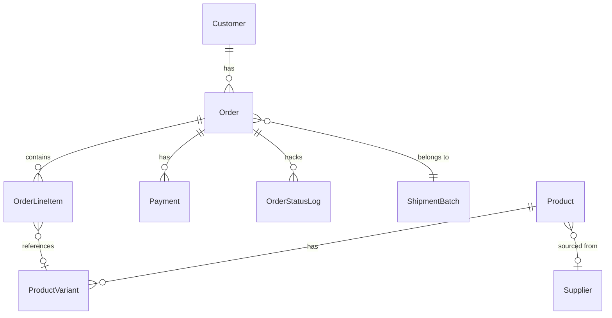
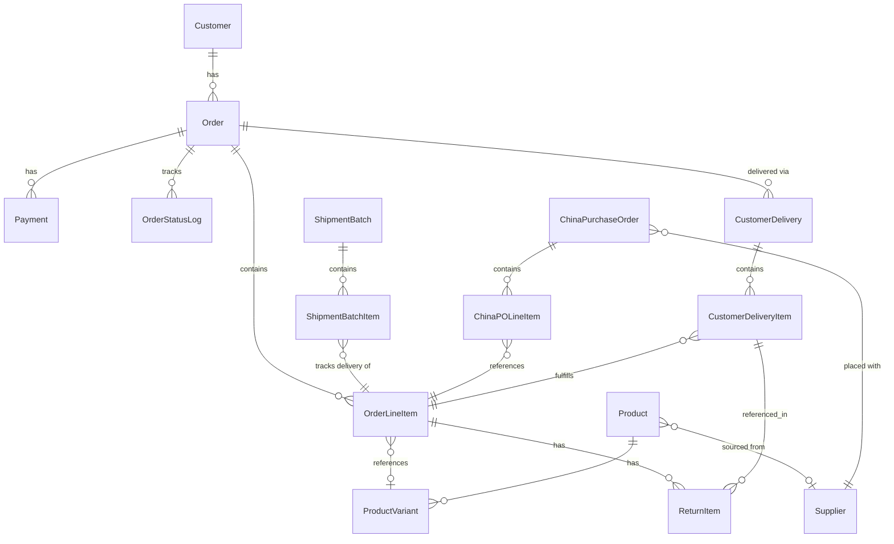

# Phân tích & Thiết kế lại CSDL cho Quản lý Đơn hàng Đa đợt

## 1. Đánh giá Schema hiện tại

### Kiến trúc hiện có



### ❌ Các vấn đề nghiêm trọng với thiết kế hiện tại

| # | Vấn đề | Giải thích |
|---|--------|------------|
| 1 | **Order ↔ ShipmentBatch là quan hệ N:1** | Mỗi Order chỉ thuộc **1 batch duy nhất**. Thực tế: 1 đơn hàng có thể được chia ra **nhiều đợt giao** → cần quan hệ **N:N** |
| 2 | **OrderStatus là cấp Order, không có cấp Line Item** | Khi SP A đã về VN nhưng SP B vẫn ở TQ, OrderStatus không thể phản ánh đúng. Cần trạng thái **riêng cho từng line item** |
| 3 | **Không có cơ chế biết "line nào đã về đợt nào"** | Thiếu bảng trung gian giữa `ShipmentBatch` và `OrderLineItem` để track số lượng thực nhận mỗi đợt |
| 4 | **Không có Purchase Order cho đối tác TQ** | Thiếu entity quản lý đặt hàng với nhà máy TQ (gom nhiều line items từ nhiều order khác nhau gửi cho cùng 1 supplier) |
| 5 | **Không có Delivery/Fulfillment cho khách cuối** | Khi hàng về VN, cần tạo vận đơn giao cho khách. Hiện schema không có model này |

---

## 2. Thiết kế mới — Giải pháp đề xuất

### Kiến trúc tổng quan mới



---

## 3. Chi tiết thay đổi Schema

### 3.1 Enums mới

```prisma
/// Trạng thái của từng line item trong đơn hàng
enum LineItemStatus {
  PENDING         // Chờ đặt hàng từ nhà máy TQ
  ORDERED         // Đã đặt cho nhà máy TQ (thuộc 1 ChinaPO)
  PRODUCING       // Nhà máy đang sản xuất
  READY_CN        // Hàng sẵn sàng tại kho TQ
  IN_TRANSIT      // Đang trên đường về VN
  ARRIVED_VN      // Đã về kho VN
  DELIVERED       // Đã giao cho khách
}

/// Trạng thái đơn đặt hàng TQ
enum ChinaPOStatus {
  DRAFT           // Đang soạn
  SENT            // Đã gửi cho nhà máy
  CONFIRMED       // Nhà máy xác nhận
  PRODUCING       // Đang sản xuất
  READY           // Hàng xong, chờ gom
  SHIPPED         // Đã gửi về VN
  COMPLETED       // Hoàn tất
}

/// Trạng thái vận đơn giao khách
enum DeliveryStatus {
  PACKING         // Đang đóng gói
  SHIPPED         // Đã gửi
  DELIVERED       // Đã giao thành công
  RETURNED        // Bị trả lại
}

enum ReturnReason {
  DEFECTIVE       // Hàng lỗi
  WRONG_ITEM      // Gửi nhầm
  WRONG_SIZE      // Sai size/màu
  CUSTOMER_CHANGE // Khách đổi ý
  OTHER           // Lý do khác
}

enum ReturnStatus {
  REQUESTED       // Khách yêu cầu trả
  APPROVED        // Đã duyệt
  RECEIVED        // Đã nhận hàng trả
  REFUNDED        // Đã hoàn tiền/đổi hàng
  REJECTED        // Từ chối
}
```

### 3.2 Model mới: ShipmentBatchItem
```prisma
model ShipmentBatchItem {
  id              String        @id @default(uuid()) @db.Uuid
  shipmentBatchId String        @db.Uuid
  lineItemId      String        @db.Uuid
  quantity        Int           // Số lượng THỰC NHẬN
  expectedQuantity Int          // Số lượng DỰ KIẾN nhận
  discrepancyNote  String?      // Ghi chú khi thừa/thiếu

  shipmentBatch   ShipmentBatch @relation(fields: [shipmentBatchId], references: [id])
  lineItem        OrderLineItem @relation(fields: [lineItemId], references: [id])
  createdAt       DateTime      @default(now())
}
```

### 3.3 Model mới: ReturnItem
```prisma
model ReturnItem {
  id              String        @id @default(uuid()) @db.Uuid
  deliveryItemId  String        @db.Uuid
  lineItemId      String        @db.Uuid
  quantity        Int
  reason          ReturnReason
  status          ReturnStatus  @default(REQUESTED)
  note            String?       @db.Text
  refundAmountVnd Decimal?      @db.Decimal(12, 2)

  deliveryItem    CustomerDeliveryItem @relation(fields: [deliveryItemId], references: [id])
  lineItem        OrderLineItem       @relation(fields: [lineItemId], references: [id])
  createdAt       DateTime      @default(now())
}
```

---

## 4. Triết lý Quản lý (Inventory & Logic)

1. **Made-to-Order**: Hệ thống không quản lý "tồn kho tĩnh" trên bảng Product. Số lượng chỉ tồn tại ở Order và các bảng vận chuyển/đặt hàng.
2. **Derived Status**: Trạng thái Order (Completed/Partial) được tính toán dựa trên `fulfilledQuantity` của các Line Items.
3. **Discrepancy Handling**: Cho phép nhận hàng thừa/thiếu so với đặt hàng bằng cách track `expectedQuantity` vs `quantity` trên Batch.
4. **Return Handling**: Khi nhận hàng trả (`RECEIVED`) -> tự động giảm `fulfilledQuantity` của sản phẩm đó.

---

## 5. Decisions Log (Đã chốt)

- **Gom PO**: Có tính năng tự động gợi ý gom line items cùng Supplier.
- **Phân quyền**: Tạm hoãn (làm sau).
- **Hàng trả**: Có model `ReturnItem` riêng.
- **Tồn kho**: Không lưu field `stock` cố định, tính toán realtime khi cần.

---

## 6. Bước tiếp theo

Khi quay lại, chúng ta sẽ:
1. Cập nhật `schema.prisma` chính thức.
2. Chạy Migration.
3. Xây dựng UI cho phần Gom PO và Quản lý Batch hàng về.
